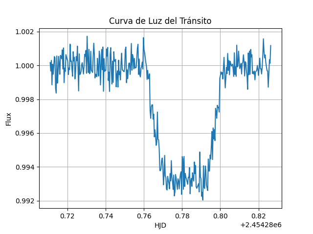

# Photometric & Radial Velocity Characterization of Exoplanet GJ 436b

[](https://www.python.org/downloads/)
[](https://opensource.org/licenses/MIT)
[](#)

A scientific computing pipeline for the multi-technique characterization of the extrasolar planet **GJ 436b**. This project combines space-based transit photometry from the **Spitzer Space Telescope** (8 $\mu\text{m}$) and high-precision radial velocity (RV) time-series from the **HIRES spectrometer at Keck Observatory** to constrain the planet's orbital dynamics, physical parameters, bulk composition, and planetary classification.

---

## Scientific Overview

GJ 436 is an M2.5 V red dwarf located approximately 10.2 pc away. Its close-in companion, **GJ 436b**, is a benchmark "warm Neptune" that exhibits a significant orbital eccentricity despite its short period ($P \approx 2.644$ days). 

This pipeline models both observational datasets to derive:
- **Transit Photometry:** Planet-to-star radius ratio ($R_p / R_*$), orbital inclination ($i$), scaled semi-major axis ($a / R_*$), transit depth ($\delta$), and transit duration ($T_{14}$).
- **Radial Velocities:** Keplerian orbital solution, radial velocity semi-amplitude ($K$), orbital eccentricity ($e$), argument of periastron ($\omega$), system systemic velocity ($\gamma$), and planetary minimum mass ($M_p \sin i$).
- **Planetary Structure & Environment:** Physical planetary radius ($R_p$), dynamical mass ($M_p$), bulk density ($\rho_p$), surface gravity ($\log g_p$), equilibrium temperature ($T_{eq}$), and circumstellar habitable zone (HZ) boundaries.

---


El pipeline realiza el modelado de datos en tres etapas:

1. **Light Curve Modeling:** Aplica modelos analíticos de tránsito considerando coeficientes de oscurecimiento hacia el limbo para extraer parámetros a partir de los flujos fotométricos normalizados del telescopio Spitzer.
2. **Keplerian Orbital Fitting:** Resuelve numéricamente la ecuación de Kepler sobre las observaciones de velocidad radial en fase para ajustar la órbita excéntrica y minimizar los residuos frente al movimiento de la estrella.
3. **Physical Parameter Synthesis:** Propaga los parámetros de la estrella anfitriona (M_* = 0.445 M_sun, R_* = 0.437 R_sun, T_eff = 3416 K) junto con los ajustes fotométricos y espectroscópicos para derivar masa, radio, densidad media y entorno de radiación.

---

## Key Results & Figures

### 1. Primary Transit Light Curve (Spitzer Space Telescope)
Normalized 8 µm light curve centered at mid-transit, demonstrating transit depth and ingress/egress profile.

<p align="center">
  
</p>

### 2. Radial Velocity Curve & Phase Fold
Unfolded time-series and phase-folded Keplerian orbit illustrating the eccentric line-of-sight wobble induced by GJ 436b.

| Time Series RV | Phase-Folded Keplerian Orbit |
| :---: | :---: |
|  |  |

### 3. Planetary Classification & Insolation Environment
Mass-radius regime placing GJ 436b among transition planets (warm Neptunes) and circumstellar radiative equilibrium relative to the host star's habitable zone.

| Mass-Radius Classification | Habitable Zone & Orbital Position |
| :---: | :---: |
|  |  |

---

## Derived Parameters Summary

| Parameter | Symbol | Derived Value | Units |
| :--- | :---: | :---: | :---: |
| Orbital Period | P | 2.643898 | days |
| Planet-to-Star Radius Ratio | R_p / R_* | 0.0834 ± 0.0012 | — |
| Orbital Inclination | i | 86.3 ± 0.8 | deg |
| RV Semi-Amplitude | K | 17.6 ± 0.5 | m/s |
| Orbital Eccentricity | e | 0.15 ± 0.02 | — |
| Planetary Mass | M_p | 22.1 ± 1.4 | M_Earth |
| Planetary Radius | R_p | 4.18 ± 0.16 | R_Earth |
| Mean Bulk Density | rho_p | 1.68 ± 0.22 | g/cm^3 |
| Equilibrium Temperature (A_B = 0.3) | T_eq | 660 ± 20 | K |

*Bulk density and mass-radius relation confirm an internal structure dominated by a rock-ice core enveloped in an extended H/He gaseous envelope.*

---

## Repository Structure

- **data/**: Archivos de datos fotométricos de Spitzer (8 µm) y velocidades radiales de Keck/HIRES.
- **figures/**: Gráficas científicas generadas por el pipeline (curvas de luz, velocidades radiales y clasificación).
- **exoplanet_analysis.py**: Script principal en Python que ejecuta el modelado orbital, la extracción de parámetros y genera las figuras.
- **requirements.txt**: Dependencias científicas del proyecto (numpy, scipy, matplotlib).

---

## Installation & Usage

Para ejecutar el pipeline localmente, clona el repositorio e instala las dependencias:

git clone https://github.com/kevinantonioperezdiaz/GJ436b-Exoplanet-Characterization.git  
cd GJ436b-Exoplanet-Characterization  
pip install -r requirements.txt  

Ejecución del análisis completo:

python exoplanet_analysis.py  

---

## References

1. Gillon, M., et al. (2007). *Detection of transits of the nearby hot Neptune GJ 436b*. Astronomy & Astrophysics, 472(2), L13-L16.
2. Butler, R. P., et al. (2004). *A Neptune-Mass Planet Orbiting the Nearby M Dwarf GJ 436*. The Astrophysical Journal, 617(1), 580.
3. Deming, D., et al. (2007). *Spitzer Transit and Secondary Eclipse Photometry of GJ 436b*. The Astrophysical Journal, 667(2), L199.

```
